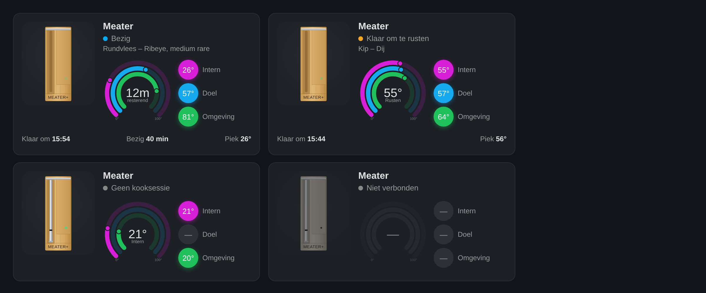

# MEATER Card

An animated Lovelace card for **MEATER** wireless meat thermometers in Home Assistant, styled to match `custom:appliance-washer-card` from [ha-appliance-electromenager-cards](https://github.com/skyrotter/ha-appliance-electromenager-cards).



## Features

- Three nested 3/4 rings in the MEATER app colours: internal (magenta), target (blue) and ambient (green) temperature, on a 0–100° scale by default
- Time to go in the centre of the rings
- Cook state (not started, started, ready for resting, resting, finished, slightly overdone, overcooked …) and the cook name
- Coloured temperature bubbles like the MEATER app; tap one to open its history
- Footer with the time the cook will be ready, elapsed time and peak temperature
- MEATER+ block illustration: the probe leaves the block while cooking, and the LED lights up when the probe is online
- Finds the MEATER sensors automatically, whatever language your entity IDs are in
- Dutch and English labels

## Requirements

- The core Home Assistant [MEATER integration](https://www.home-assistant.io/integrations/meater/)

## Installation

[](https://my.home-assistant.io/redirect/marketplace_repository/?owner=nosehook&repository=meater-card&category=plugin)

<!-- ha-marketplace:exclude-start -->
### HACS / Marketplace (custom repository)
1. Add `https://github.com/nosehook/meater-card` as a custom repository, category **Dashboard**.
2. Install **MEATER Card** and reload your browser.

### Manual
1. Copy `meater-card.js` to `/config/www/`.
2. Settings → Dashboards → ⋮ → Resources → add `/local/meater-card.js` as a **JavaScript module**.
<!-- ha-marketplace:exclude-end -->

## Configuration

```yaml
type: custom:meater-card
```

| Option | Default | Description |
|---|---|---|
| `name` | `Meater` | Card title |
| `device_id` | first MEATER probe | Pick a specific probe when you have more than one |
| `min` / `max` | `0` / `100` | Ring scale in degrees |
| `language` | `nl` | `nl` or `en` |
| `internal`, `ambient`, `target` | auto | Temperature sensors |
| `cook_state` | auto | Cook state sensor |
| `remaining` | auto | Time remaining (timestamp sensor) |
| `elapsed` | auto | Time elapsed (timestamp sensor) |
| `cook_name`, `peak` | auto | Cook name and peak temperature |

Entities are found automatically from the MEATER integration; set them explicitly only if you want to override them.

## License

MIT
